

<!-- Tous les visuels de assets/ sont générés par cards/build.py -->

### 

<a href="https://rift.ddns.net"></a>
<a href="https://github.com/Terrenoss/Mimic-Reborn"></a>

Aussi sur l'établi : **[Stats-Of-Legends](https://github.com/Terrenoss/Stats-Of-Legends)** (web Next.js)

### 

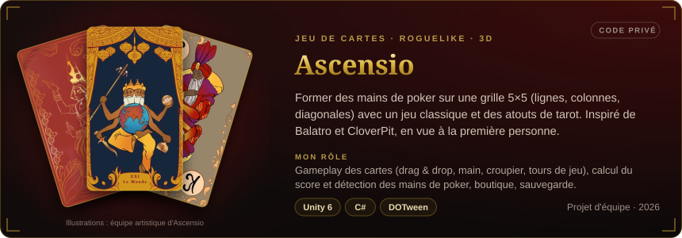

<a href="https://github.com/The-Turkeys-Men/TurkeyShowdown">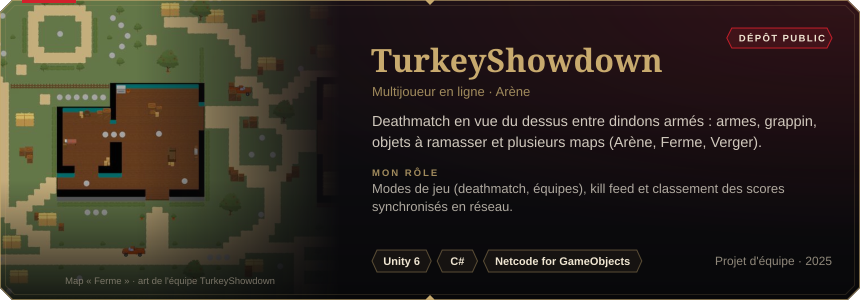</a>

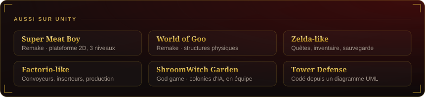

### 


### 

  

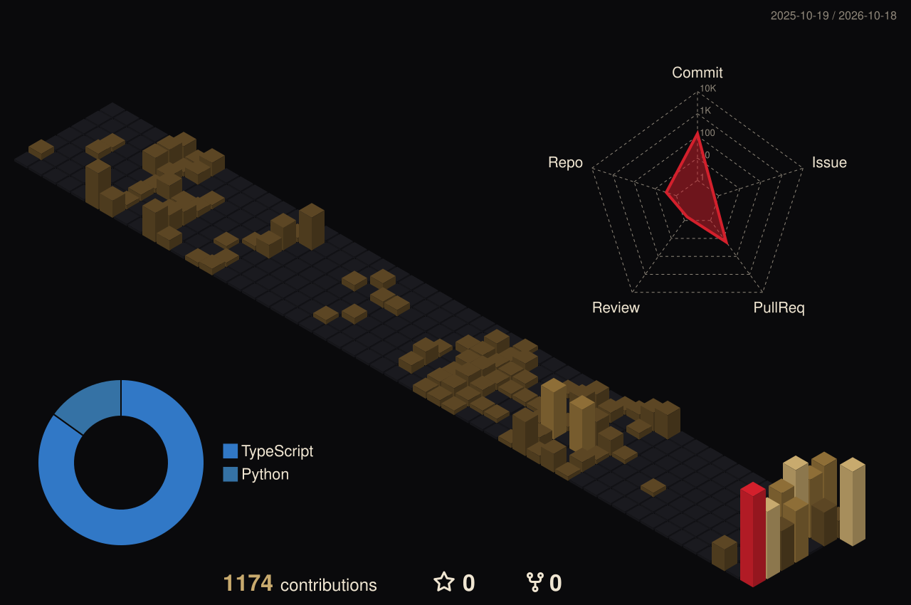

